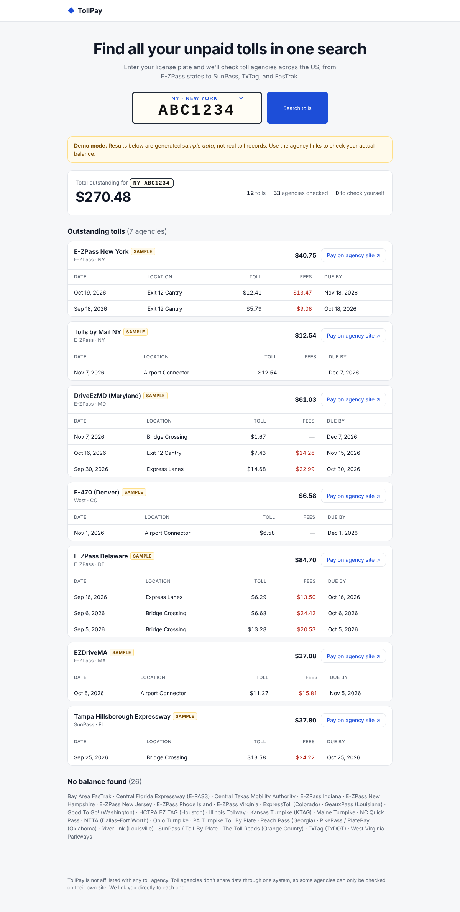

# TollPay

Enter a license plate and issuing state, and TollPay checks every US toll agency it knows about for outstanding tolls. It shows one total, an itemized list for each agency, and a link to each agency's own pay-by-plate portal.



## Run it

```bash
npm start          # http://localhost:3000
npm test
```

No dependencies are needed. It requires Node 18 or later.

| Env var     | Default                               | Meaning |
|-------------|---------------------------------------|---------|
| `PORT`      | `3000`                                | HTTP port |
| `DEMO_MODE` | `true` unless `NODE_ENV=production`   | Fill results with clearly labeled **sample** tolls |

## How lookups work (and the important caveat)

No public, unified API exists for US toll balances. Each agency (the E-ZPass members, SunPass, TxTag, NTTA, FasTrak, and others) runs its own system. Most have no public plate-lookup API, and many prohibit automated scraping in their terms of service.

So every agency is a **provider** in `src/providers/agencies.js`, and each one ends up in one of these states:

- **manual** (the default): the site can't query the agency, so it links the user to the agency's portal. Agencies in the plate's home state are listed first.
- **found / clear**: the agency has a `lookup()` function that returns real data.
- **error**: the agency's `lookup()` threw an error or timed out (8 s). The user gets the agency link instead.

All agencies are queried in parallel. One agency failing never breaks the whole search.

### Adding a live data source

Give an agency entry a `lookup` function, for example through a licensed toll-data partner or an agency API you have credentials for:

```js
{ id: 'tx-ntta', name: 'NTTA', network: 'Texas', states: ['TX'], url: 'https://www.ntta.org',
  async lookup(plate, state) {
    const res = await fetch(`https://partner.example/tolls?plate=${plate}&state=${state}`, {
      headers: { Authorization: `Bearer ${process.env.PARTNER_KEY}` },
    });
    const { items } = await res.json();
    return {
      status: items.length ? 'found' : 'clear',
      tolls: items.map((i) => ({ id: i.id, date: i.date, location: i.plaza, amount: i.toll, fees: i.fees, dueDate: i.due })),
    };
  } }
```

## Project layout

```
server.js                 zero-dependency HTTP server + JSON API (POST /api/lookup, GET /api/config)
src/states.js             state list, plate/state validation
src/providers/agencies.js toll agency registry (names, coverage, portal URLs)
src/providers/demo.js     deterministic sample-data generator (demo mode only)
src/providers/index.js    parallel fan-out, timeouts, totals, sorting
public/                   static front end (HTML/CSS/JS, no build step)
test/                     node:test suites
```

## Security notes

- Plates are sent by POST, so they don't end up in URLs or access logs.
- Strict CSP, no inline scripts, and all rendering uses `textContent`.
- In-memory rate limit of 30 lookups per minute per IP. Put a real limiter behind a proxy in production.
- Nothing is stored server-side. The browser remembers only the last selected state.
